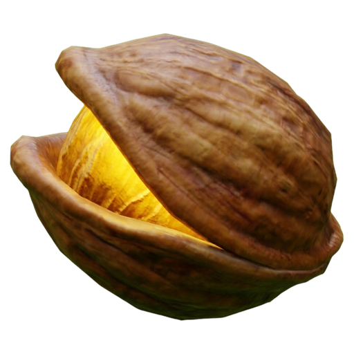

# DekooNut

A native PC build of *The Legend of Zelda: Ocarina of Time* for Nintendo Switch 2 (update 1.1.1). The game's own
code is recompiled to C ahead of time and linked with a runtime that stands in for the console: memory, threads,
system services, files, audio, input, and the graphics API, which is recorded and replayed on Vulkan.

Everything happens on your PC, from your own copy of the game.

> [!IMPORTANT]
> This repository **does not contain the game, any game file, keys or a built executable**, and it does not explain
> how to get them. **You need your own legally obtained copy of the game.** Everything the build creates (the
> generated code, the `oot` program, the shader caches, your saves) comes from your copy and stays on your PC. Never
> share those files, and never add them here: `tools/check_content.py`, which also runs as the pre-commit hook,
> refuses game files, keys and generated game code.

- The repository holds no keys and no tool that decrypts game files or gets around copy protection.
- A build is for the PC it was made on. Do not pass builds on: a build contains code generated from your game, and
  it links NVIDIA's DLSS library, whose licence does not allow it to be redistributed with this program.
- Questions about where to get the game are not answered here; such requests are closed.
- The software is provided as it is, without warranty of any kind. Use it at your own risk.

DekooNut is an unofficial project. It is not affiliated with, endorsed by or supported by Nintendo. The Legend of
Zelda and Ocarina of Time are trademarks of Nintendo.

Linux x86-64 with an NVIDIA GPU is what the build is played on: 4K output through DLSS at 60 fps. The Windows side
of the runtime (`runtime/platform/win32.c`, the `*_win.c` files) is kept in step with the Linux side but is not
built or tested.

## What you need

- Your own legally obtained copy of the game, update 1.1.1, dumped from your own console.
- Linux x86-64 and a graphics card with Vulkan 1.3 and mesh shaders. DLSS needs an NVIDIA card and the NVIDIA DLSS
  SDK; without them the game uses its other upscaler.
- To build: clang, lld, ninja, cmake, Python 3.12 and 3.14, the .NET 10 SDK, and the development files of Vulkan,
  SDL3, Opus, libvpx, dav1d and zstd.

## Build and run

    python3.14 tools/extract_nup.py <game>.nup --out build/extracted/oot111-dump
    python3 tools/nso_plain.py build/extracted/oot111-dump/exefs build/extracted/oot111/exefs
    python3 tools/pack_romfs.py --dir build/extracted/oot111-dump/romfs --out build/romfs-oot111
    .venv/bin/python recomp/gen.py --exefs build/extracted/oot111/exefs --out generated/oot111 --patches recomp/patches-oot111.txt
    python3 tools/build_xlate.py
    python3 tools/build_mesh.py
    python3 tools/build_game.py --exefs build/extracted/oot111/exefs --romfs build/romfs-oot111 --out build/oot111 --dlss-sdk <DLSS SDK dir>
    tools/prepare_oot.sh build/oot111
    cd build/oot111 && OOT_XLATE=../xlate/oot_xlate ./oot

Each step, what it needs and what it writes: [docs/building.md](docs/building.md). Settings are in `oot.ini` next to
`oot` (see `oot.ini.example`) and in the in-game menu.

## More

- [docs/building.md](docs/building.md): requirements, every build step, running, the layout of the repository.
- [docs/how-it-works.md](docs/how-it-works.md): how the runtime works, by topic.
- [THIRD_PARTY_NOTICES.md](THIRD_PARTY_NOTICES.md): third-party code, its sources and licences.

## Licence

Copyright (c) 2026 Mr-Renegade and contributors.

DekooNut as a whole is under the [GNU General Public License, version 3 or later](LICENSE): it includes GPL code.
Files adapted from MIT-licensed projects keep that licence ([LICENSE-MIT](LICENSE-MIT)) and their copyright notice at
the top of the file. Every piece of third-party code, its source, revision and licence is listed in
[THIRD_PARTY_NOTICES.md](THIRD_PARTY_NOTICES.md). The licences grant nothing for Nintendo's game.

The icon in `assets/` is a placeholder picture made for this repository; it is not taken from the game.
